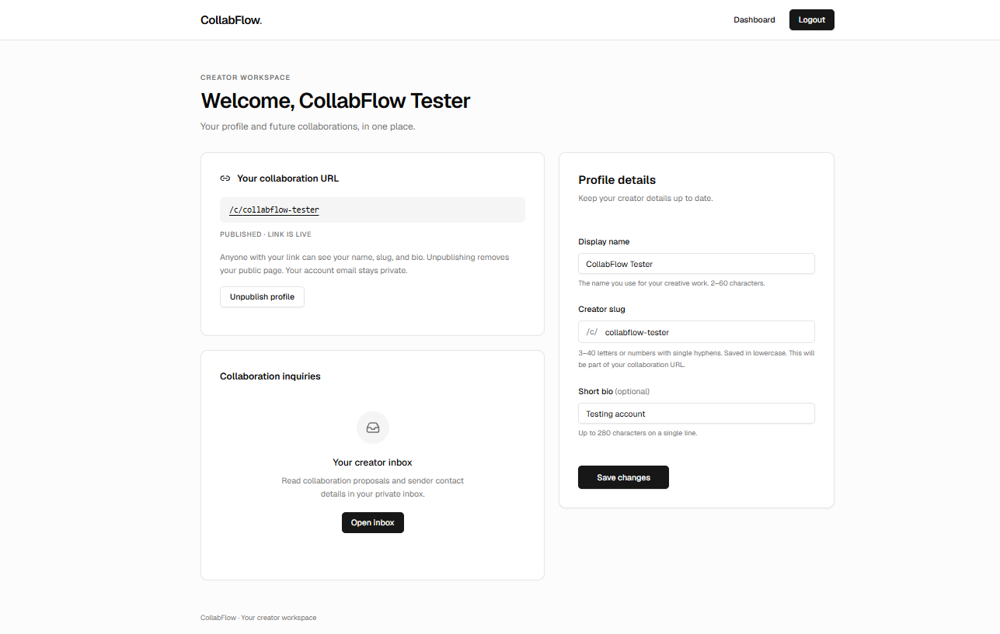
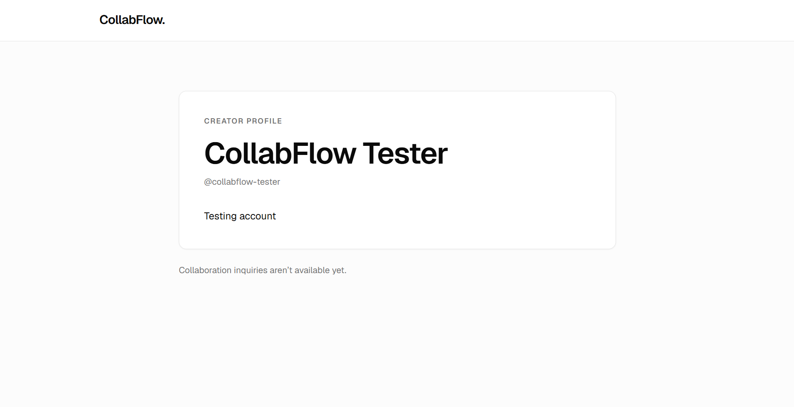
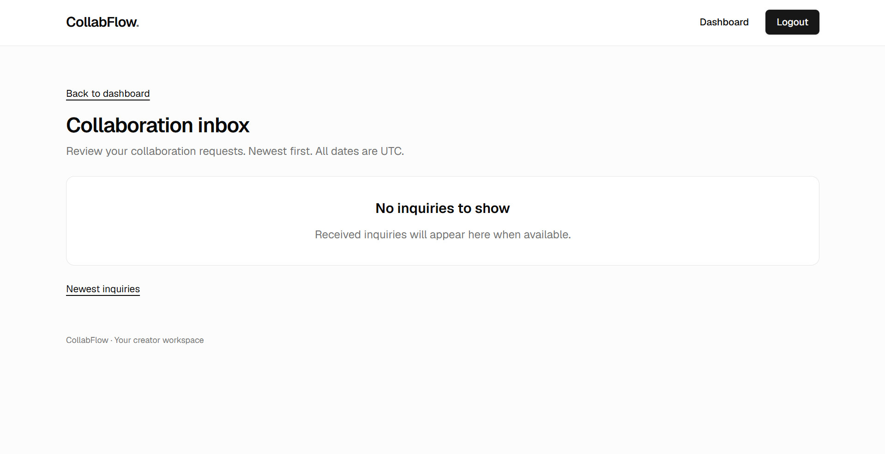
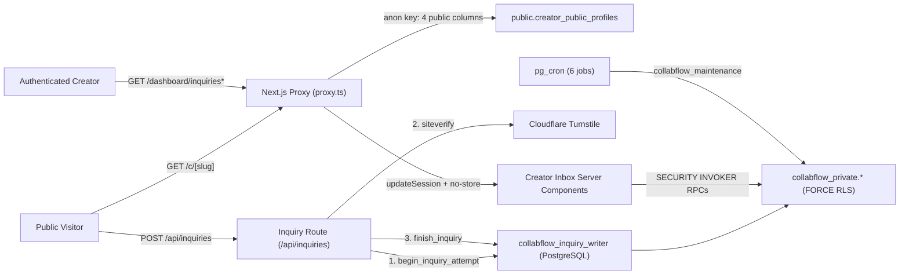

# CollabFlow

CollabFlow is a full-stack creator profile and collaboration inquiry intake SaaS MVP built with Next.js, TypeScript, Supabase, PostgreSQL, and Cloudflare Turnstile.

It lets creators manage a private workspace, optionally publish a public profile page at `/c/[slug]`, receive spam-protected collaboration proposals without exposing their personal email address, and review incoming proposals in a private, owner-scoped inbox.

## Overview

Creators who publish a business email address online face spam, scraping, and unstructured outreach. CollabFlow separates public creator discovery from private contact handling:

- Creators start with a private profile and explicitly opt in to publishing only approved public fields (`display_name`, `slug`, and optional `bio`).
- Visitors submit collaboration proposals through a public intake endpoint protected by server-verified Cloudflare Turnstile, durable PostgreSQL rate limits, and idempotent receipts.
- Creators read received proposals inside an authenticated, read-only inbox backed by PostgreSQL Row Level Security (RLS) and `SECURITY INVOKER` RPCs.
- New inquiries follow a 180-day active-database retention policy enforced by bounded scheduled cleanup jobs.

The project is intentionally scoped as a focused MVP rather than a creator marketplace.

## Screenshots

Captured from the `collabflow-dev` testing environment using a test creator account (`CollabFlow Tester`).

### Creator Dashboard

Authenticated creator workspace showing the live `/c/collabflow-tester` publication toggle, profile editor, and entry point to the private inbox.



### Public Creator Profile (Inquiry Intake Disabled)

Published creator page at `/c/collabflow-tester` displaying only the approved public fields (display name, slug, and bio) with public inquiry intake disabled (`INQUIRIES_ENABLED=false`).



### Collaboration Inbox (Empty State)

Authenticated read-only Creator Inbox at `/dashboard/inquiries` shown in its empty state with no received inquiries displayed.



## Implemented Features

- **Creator authentication and session boundaries:** Email/password sign-up, email confirmation (`/auth/confirm` with an exact redirect allowlist), sign-in, password reset/update, sign-out, and compatibility routing for `/protected`.
- **Onboarding and private dashboard:** Single-profile-per-user onboarding (`/onboarding`) and profile management (`/dashboard`) with server-side validation, reserved slug enforcement, and concurrent creation handling.
- **Opt-in public creator profiles:** Explicit publish/unpublish controls on the dashboard and public profile pages at `/c/[slug]` backed by a separate 4-column projection table (`public.creator_public_profiles`). Unpublished, unknown, and invalid slugs return HTTP `404` directly without redirecting to login.
- **Feature-gated collaboration inquiry intake:** Public form on `/c/[slug]` and `POST /api/inquiries` endpoint enabled only when `INQUIRIES_ENABLED=true` and `TURNSTILE_SITE_KEY` are configured. Includes client-side disclosure, honeypot filtering, streamed body-size/timeout caps, origin and Fetch Metadata checks, server-verified Turnstile, durable rate limits, and idempotent submission receipts.
- **Private read-only Creator Inbox:** Authenticated list (`/dashboard/inquiries`) and detail (`/dashboard/inquiries/[id]`) views with keyset cursor pagination (20 items per page, newest first, UTC timestamps), safe handling of standard UTM referral query parameters, and uniform not-found behavior for unknown and foreign-owned IDs.
- **180-day inquiry retention and cleanup operations:** Policy metadata (`retention_days = 180`, immutable `retention_effective_at` cohort boundary), bounded `FOR UPDATE SKIP LOCKED` cleanup function (`collabflow_private.cleanup_inquiry_data`), and opt-in SQL operational scripts for preflight, activation, monitoring, and emergency pause.

**Not implemented in this MVP:** email notifications, in-app replies or chat, inquiry status management (archive/read/star), AI matching, payment processing, analytics dashboards, or sender-side portals to view or edit submitted inquiries.

## Tech Stack

- **Framework & UI:** Next.js 16 (`16.4.6`, App Router, `cacheComponents: true`), React 19, TypeScript 5, Tailwind CSS 3, Radix UI / shadcn/ui primitives, Lucide icons.
- **Auth & Database:** Supabase Auth (`@supabase/ssr`, `@supabase/supabase-js`), PostgreSQL with RLS and `FORCE RLS`, `postgres` client for restricted inquiry-writer transactions, Supabase `pg_cron` for scheduled cleanup.
- **Abuse Protection:** Cloudflare Turnstile (explicit client widget + server-side Siteverify API).
- **Testing & Hosting:** Node.js built-in test runner (`node:test`), `@electric-sql/pglite` (in-memory PostgreSQL for SQL/RLS tests), ESLint 9, Vercel (DEV deployment).

## Architecture and Request Flow



- **Public profile reads (`GET /c/[slug]`):** `proxy.ts` validates canonical slug format before querying `public.creator_public_profiles` with the publishable/anonymous key (`cache: "no-store"`), strips any browser-supplied profile header, and returns direct `404`/`503` HTML responses on misses or backend errors.
- **Inquiry intake (`POST /api/inquiries`):** `proxy.ts` bypasses Supabase session handling for exact path `/api/inquiries`. The route validates `INQUIRIES_ENABLED`, exact `Origin`, Fetch Metadata, Vercel's `x-vercel-forwarded-for` header, streamed payload size (32 KiB max, 5s read timeout), and fields, then executes a two-phase database flow (`begin_inquiry_attempt` → Cloudflare Siteverify → `finish_inquiry`) using a restricted PostgreSQL login role.
- **Creator workspace & inbox (`/dashboard*`, `/onboarding`, `/protected`):** `proxy.ts` refreshes Supabase Auth cookies via `@supabase/ssr` and applies `Cache-Control: private, no-store, max-age=0` and `X-Robots-Tag: noindex, nofollow`. Server Components verify `auth.getUser()` on every request and read inquiries exclusively through `SECURITY INVOKER` RPCs (`public.list_creator_inquiries`, `public.get_creator_inquiry`).

## Security and Privacy Design

- **Strict public/private separation:** `public.creator_profiles` is owner-only under `FORCE RLS`. Publishing copies only `public_id`, `slug`, `display_name`, and `bio` into `public.creator_public_profiles` via a trigger owned by `collabflow_profile_projector` (`NOLOGIN`, `NOINHERIT`, `NOBYPASSRLS`). `public_id` is distinct from `auth.users.id`.
- **Least-privilege database roles (no service-role key in app code):**
  - `collabflow_inquiry_writer` can execute only `begin_inquiry_attempt` and `finish_inquiry`, with no direct table grants and per-role timeouts (`statement_timeout = 5s`, `lock_timeout = 2s`).
  - `collabflow_inquiry_executor` owns the intake functions and has insert-only access to inquiry content.
  - `collabflow_cleanup_executor` and `collabflow_maintenance` handle bounded expiry deletion without read access to sender name, email, company, or message text.
  - All private inquiry tables reside in `collabflow_private` with `ENABLE` and `FORCE RLS`. `collabflow_private` must remain excluded from Supabase PostgREST exposed schemas.
- **Durable abuse controls and idempotency:** Rate limits are enforced in PostgreSQL across 7 fixed-window scopes (preflight and accepted stages) using HMAC-SHA256 digests of normalized IP/IPv6 `/64` buckets, emails, and payloads. Turnstile verification binds `hostname`, `action`, and `creatorPublicId_submissionId`, backed by a SHA-256 token replay table and row-level publication locking (`FOR SHARE`). Submission receipts acknowledge delivery only; they do not grant the sender permission to read, edit, or delete an inquiry.
- **Owner-scoped inbox and hardened auth boundaries:** Both inbox RPCs use `SECURITY INVOKER`, empty `search_path`, explicit `auth.uid()` checks, and owner-scoped RLS with column-scoped `SELECT` grants. Unknown inbox query parameters are rejected while five standard lowercase UTM parameters (`utm_source`, `utm_medium`, `utm_campaign`, `utm_content`, `utm_term`) are ignored without reading or propagating their values. `/auth/error` renders only allowlisted error codes (never reflecting arbitrary query text), and `/auth/confirm` allows only exact pre-approved redirect destinations.
- **Active-database retention vs. backups:** New inquiries are assigned a 180-day `retention_due_at` deadline in CollabFlow's active database and removed by bounded scheduled cleanup after that deadline (deletion is not guaranteed to occur at exactly 180 days). Legacy or `NULL`-deadline records prior to `retention_effective_at` are excluded from automatic deletion. Infrastructure database backups follow separate provider backup retention policies.

## Local Development Setup

### Prerequisites

- Node.js 20+ and npm
- A disposable/local Supabase project for interactive development (do not point local development at production credentials)

### 1. Clone and install

```bash
git clone https://github.com/prisandikevin12/Collabflow.git
cd Collabflow
npm install
```

### 2. Configure environment variables

Copy `.env.example` to `.env.local` and supply values for your disposable development project:

```bash
cp .env.example .env.local
```

> **Note:** `.env.example` currently contains only the two required baseline Supabase variables (`NEXT_PUBLIC_SUPABASE_URL` and `NEXT_PUBLIC_SUPABASE_PUBLISHABLE_KEY`). It does not list the optional inquiry intake variables below.

| Variable | Required | Purpose |
| --- | --- | --- |
| `NEXT_PUBLIC_SUPABASE_URL` | Yes | Supabase project URL |
| `NEXT_PUBLIC_SUPABASE_PUBLISHABLE_KEY` | Yes | Supabase publishable (or legacy anon) API key |
| `INQUIRIES_ENABLED` | Optional (default disabled) | Must be exact `true` to enable the public form and `POST /api/inquiries` |
| `TURNSTILE_SITE_KEY` | When intake enabled | Public Cloudflare Turnstile widget key |
| `TURNSTILE_SECRET_KEY` | When intake enabled | Server-only Turnstile Siteverify secret |
| `TURNSTILE_ALLOWED_HOSTNAMES` | When intake enabled | Comma-separated exact authorized hostnames |
| `INQUIRY_ALLOWED_ORIGINS` | When intake enabled | Comma-separated exact allowed request origins |
| `INQUIRY_HMAC_SECRET` | When intake enabled | Server-only high-entropy secret (minimum 32 characters) |
| `INQUIRY_DATABASE_URL` | When intake enabled | Server-only PostgreSQL URL for `collabflow_inquiry_writer` (TLS verified, no query/fragment) |
| `INQUIRY_DATABASE_CA` | Optional | Custom PEM CA certificate for PostgreSQL TLS verification |

**Important operational rules:**
- Never use `postgres`, admin, or `service_role` credentials for `INQUIRY_DATABASE_URL`.
- Do not bypass Turnstile verification or forge `VERCEL=1` / `x-vercel-forwarded-for` to expose an unverified public deployment outside trusted Vercel ingress.
- For a **brand-new disposable database**, apply the five migrations in `supabase/migrations/` in chronological order once. **Do not reapply migrations to the existing hosted DEV database (`collabflow-dev`), where all five migrations are already applied.**

### 3. Available npm scripts

Scripts defined in `package.json`:

| Command | Description |
| --- | --- |
| `npm run dev` | Start Next.js development server |
| `npm run build` | Create production Next.js build |
| `npm run start` | Start built production server |
| `npm run lint` | Run ESLint across the repository |
| `npm run typecheck` | Run TypeScript type checking (`tsc --noEmit`) |
| `npm test` | Run unit and PGlite PostgreSQL suites (`tests/*.test.mjs`) |
| `npm run test:http` | Run production HTTP integration suites (`tests/integration/*.http.mjs`) |
| `npm run test:cleanup:postgres` | Run optional multi-session `SKIP LOCKED` cleanup test against a disposable loopback PostgreSQL instance |

*(On Windows with restricted PowerShell script execution policies, invoke `npm.cmd` instead of `npm`.)*

## Testing and Validation

### Local automated verification (independently reproducible)

Latest reported local verification (commit `caeb00e`):

- **`npm test`:** 197 passed, 0 failed, 0 skipped. Covers auth/redirect policy, error code allowlisting, private route headers, profile/slug validation, public projection logic, inquiry validation/Turnstile/HMAC/idempotency, inbox cursor/UTM rules, `.env` exclusion rules, and executable PostgreSQL RLS/grants/trigger/retention/inbox assertions in disposable in-memory PGlite databases.
- **`npm run lint` & `npm run typecheck`:** Passed.
- **Isolated production build & `npm run test:http`:** 37 passed, 0 failed, 0 skipped. Runs against a production `next start` server in an isolated source copy without `.env.local`, using local loopback Auth/PostgREST fixtures to test public profiles (`200`/`404`/`503`), disabled/enabled inquiry intake, privacy disclosures, auth error handling, private route `no-store` headers, SSR cookie refresh/clearing, cross-session inbox isolation, and UTM query handling.
- **`npm run test:cleanup:postgres`:** Optional multi-session concurrency test requiring an explicitly supplied disposable loopback PostgreSQL URL (`COLLABFLOW_CLEANUP_TEST_DATABASE_URL`); skips when unconfigured.

### Owner-reported hosted DEV checks (separate from local automation)

The project owner has reported the following completed checks on the hosted `collabflow-dev` environment:

- All five database migrations (`20261119000100` through `20261120000200`) applied, with RLS and `FORCE RLS` enabled, restricted role permissions verified, `SECURITY INVOKER` inbox RPCs installed, and `collabflow_private` excluded from exposed Data API schemas.
- Six `pg_cron` retention/cleanup jobs scheduled and observed executing on DEV.
- Vercel DEV deployment verified end-to-end with two real authenticated creator accounts (confirming cross-account inbox isolation) and a live inquiry-to-inbox submission test before returning `INQUIRIES_ENABLED` to `false`.

**Scope of evidence:** Local automated tests and owner-reported DEV checks do **not** prove production-scale load capacity, full multi-connection lock contention under traffic, or live deletion of naturally expired 180-day production rows.

## Current Status and Limitations

- **DEV/testing deployment only:** `collabflow-dev` (`https://collabflow-dev.vercel.app`) is a **development and testing deployment**, not a publicly launched or production-hardened service. Access may require authentication via Vercel Deployment Protection, so anonymous public access is not guaranteed.
- **Inquiry intake gated off in DEV:** After completing live end-to-end DEV testing, `INQUIRIES_ENABLED` remains `false` in DEV. While intake is disabled, public profile pages hide the submission form and `POST /api/inquiries` returns `404`, while authenticated creators can still read previously received inquiries in `/dashboard/inquiries`.
- **Operational and hosting limits:**
  - Running on Supabase Free tier imposes a 500 MB database limit and inactivity pausing, which can halt `pg_cron` execution and cannot sustain the theoretical maximum quota envelope for 180 days without capacity planning or lower caps.
  - A full legal privacy policy and provider backup-retention disclosure have not been published; the inquiry form intentionally limits its notice to CollabFlow's active-database behavior and includes no placeholder policy links.
  - Only the five standard lowercase UTM query parameters are ignored on `/dashboard/inquiries`; other unknown query parameters intentionally display the invalid-page state.
  - Platform-level volumetric DDoS/rate limits and external automated alerting on `pg_cron` failures remain outside the application codebase.

## Technical Documentation

Historical milestone implementation guides and verification logs (maintained as point-in-time records):

- [Milestone 1: creator onboarding and dashboard](./docs/milestone-1.md)
- [Milestone 2A.1: opt-in public creator profiles](./docs/milestone-2a-1.md)
- [Milestone 2A.2: collaboration inquiry intake](./docs/milestone-2a-2.md)
- [Milestone 2A.2B: 180-day inquiry retention and cleanup runbook](./docs/milestone-2a-2b.md)
- [Milestone 2A.3A: read-only creator inbox](./docs/milestone-2a-3a.md)

Database schema and opt-in operational SQL scripts:

- Migrations: [`supabase/migrations/`](./supabase/migrations/) (`20261119000100_creator_profiles.sql` through `20261120000200_creator_inbox.sql`)
- Retention & Cron operations (opt-in, fail-closed): [`inquiry-retention-preflight.sql`](./supabase/operations/inquiry-retention-preflight.sql), [`inquiry-cleanup-activate.sql`](./supabase/operations/inquiry-cleanup-activate.sql), [`inquiry-cleanup-monitor.sql`](./supabase/operations/inquiry-cleanup-monitor.sql), [`inquiry-cleanup-stop.sql`](./supabase/operations/inquiry-cleanup-stop.sql)

Repository: https://github.com/prisandikevin12/Collabflow
